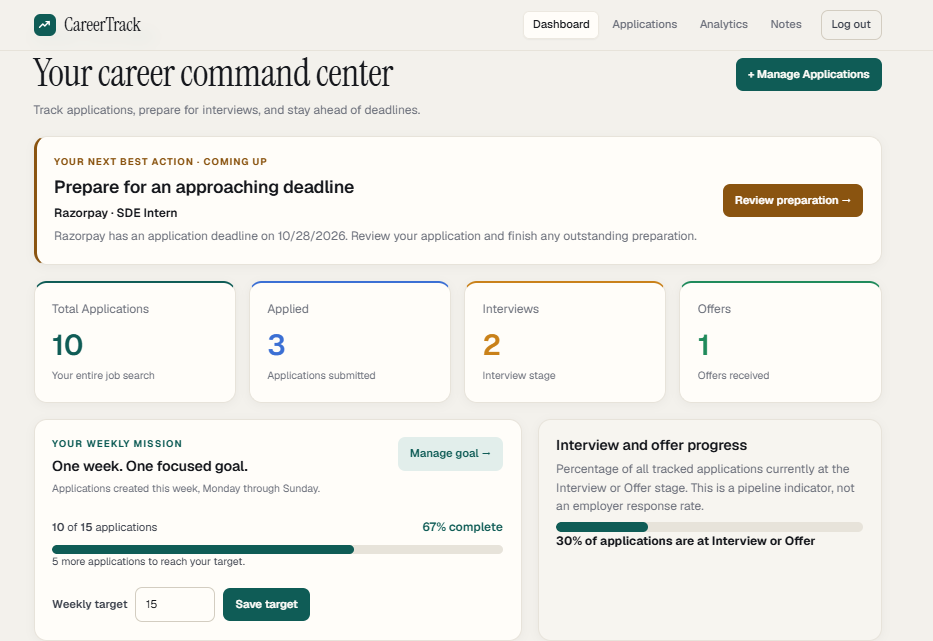
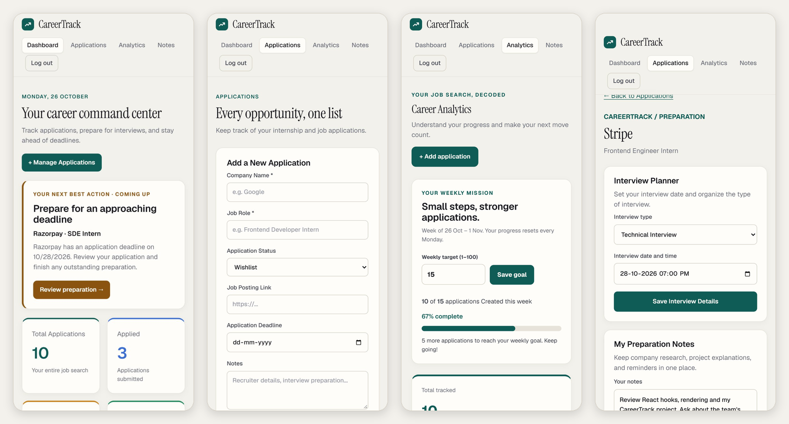
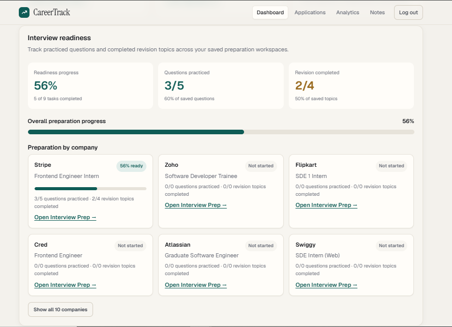

# CareerTrack

A job-search tracker for managing applications, deadlines and interview preparation in one place. This repository is the React frontend; it talks to a separate REST API.

**Live demo:** https://careertrack-app.onrender.com

**Demo account:** `careertrack@demo` / `demo0123` 

> The backend runs on Render's free plan, so the first request after a quiet period can take 30-60 seconds while the server wakes up.

**Backend repository:** https://github.com/Saraa-04/careertrack-backend

## Screenshots







## Why I built it

Tracking a job search in a spreadsheet means missed deadlines and scattered interview notes. CareerTrack keeps every application, its deadline and its interview prep together, and shows weekly progress so the search stays consistent.

## Features

- **Authentication:** register and log in with JWT; protected routes; an expired session sends you back to login.
- **Applications:** add, edit, delete, search, filter by status and sort by deadline. Deadlines show as overdue, due soon or on track, and are compared in local time so a due-today deadline is never marked overdue.
- **Dashboard:** pipeline overview, deadline alerts, upcoming interviews, weekly application goal, and interview-readiness progress per company.
- **Analytics:** pipeline breakdown, last-7-days activity, interview and offer rates, and a weekly goal you can edit.
- **Interview preparation:** per-application workspace with interview date and type, notes, a question bank with a practised toggle, and a revision checklist.
- **Notes:** free-form notes with create, edit and delete.
- **Responsive and accessible:** works down to 360px wide; labelled form fields, visible keyboard focus, reduced-motion support.

## Tech stack

| Area | Choice |
|---|---|
| UI | React 19 |
| Build tool | Vite |
| Routing | React Router 7 |
| Styling | Plain CSS with design tokens (CSS variables), no UI framework |
| State | React hooks (`useState`, `useEffect`, `useMemo`) |
| Backend | Separate REST API (see below) |

## Project structure


src/
  components/   Navbar, AuthShell (shared auth layout)
  pages/        Dashboard, Applications, Analytics, InterviewPreparation, Notes, login, register
  routes/       Route table and the protected layout
  services/     apiClient.js (all HTTP, auth header, 401 handling) + one file per API area
  utils/        dates.js (shared date helpers)
  index.css     Design tokens and shared component styles


All network calls go through `services/apiClient.js`, which adds the bearer token, parses errors into readable messages, and on a 401 clears the saved token and redirects to login.

## Getting started

Requirements: Node 20+ and the CareerTrack API running locally.

```bash
npm install
cp .env.example .env.local   # then edit if your API is not on localhost:5000
npm run dev
```

### Environment variables

| Variable | Purpose | Default |
|---|---|---|
| `VITE_API_URL` | Base URL of the API, including `/api` | `http://localhost:5000/api` |

Vite reads these at build time, so set `VITE_API_URL` in your host's environment settings before building a deployment.

### Scripts

| Command | What it does |
|---|---|
| `npm run dev` | Start the dev server |
| `npm run build` | Production build to `dist/` |
| `npm run preview` | Serve the production build locally |
| `npm run lint` | Run ESLint |

## API the frontend expects

| Area | Endpoints |
|---|---|
| Auth | `POST /auth/register`, `POST /auth/login` (returns `token`) |
| Applications | `GET/POST /applications`, `PUT/DELETE /applications/:id` |
| Notes | `GET/POST /notes`, `PUT/DELETE /notes/:id` |
| Goals | `GET/PUT /goals` (`weeklyApplicationTarget`) |
| Interview prep | `GET/POST/PUT/DELETE /interview-preparation/:applicationId` |

Every route except auth expects an `Authorization: Bearer <token>` header.

## Design decisions

- **One API client** instead of repeated `fetch` code, so auth headers and session expiry are handled in a single place.
- **Local-time date handling** (`utils/dates.js`) so deadlines don't shift a day across timezones.
- **Design tokens** in CSS variables, so the palette and spacing can change in one file.

## Known limitations

- The token is stored in `localStorage`; httpOnly cookies would be safer against XSS.
- The dashboard requests interview preparation once per application. A single summary endpoint would scale better.
- No automated tests yet.
- Weekly goals count when an application was created, not when it was applied to.

## Roadmap

- Move statuses to a drag-and-drop board
- Add an "applied on" date
- Add unit tests for deadline and goal logic
